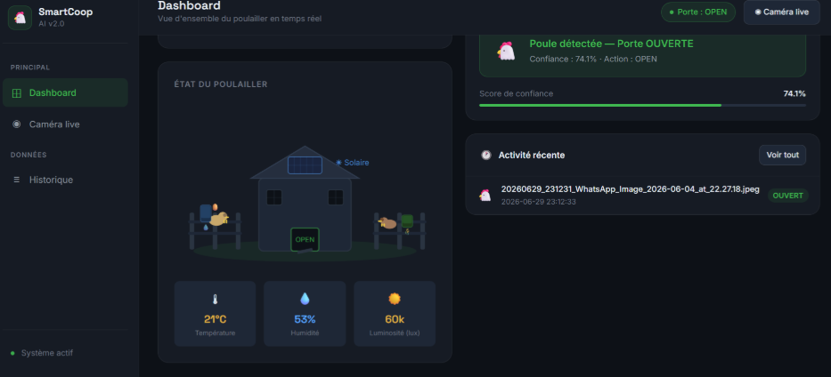
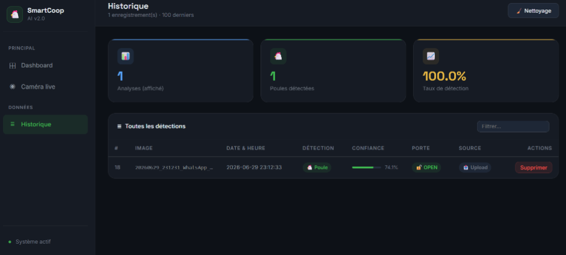

# 🐔 Smart Chicken Coop AI

An automated chicken coop door controlled by computer vision. A **YOLOv8** model detects chickens from a webcam, a **Flask** dashboard shows what is happening and lets the owner take control, and an **ESP32** with a servo opens or closes the door.

## Screenshots




## Features

- **Chicken detection** with a custom-trained YOLOv8m model (inference at 1024 px to catch distant birds)
- **Two-stage filtering**: a COCO-pretrained YOLOv8n first rejects frames containing people, cats, dogs, horses, cows and other large animals, then the chicken model counts chickens
- **Chicken counting** against a configurable flock size (`TOTAL_CHICKENS`)
- **Day/night logic** based on real sunrise and sunset times for Casablanca (fetched from the sunrise-sunset.org API, with fallback defaults)
- **Automatic capture** from the camera every few seconds, with results saved to SQLite
- **Web dashboard** with live status, detection history, and manual door override (Open / Close / return to AI)
- **REST endpoints** for the ESP32 to send sensor data and read the door state

## How the door decision works

Priority order, from `decide_door()` in `app.py`:

1. **Manual override** set by the owner always wins
2. **Night** → `CLOSE`
3. **All chickens counted inside** (`count >= TOTAL_CHICKENS`) → `CLOSE`
4. **Chicken detected during the day** → `OPEN`
5. Otherwise → `CLOSE`

## Architecture

```
 Webcam (Logitech C270)
        │
        ▼
 Flask app (app.py) ── COCO filter ─► YOLOv8m chicken model ─► door decision
        │                                                          │
        ├─► SQLite (detections.db)                                 │
        ├─► Dashboard (/dashboard, /history)                       ▼
        │                                              GET /api/door/status
        ▼                                                          │
 ESP32 ── POST /api/sensor (LDR) ◄────────────────────────────────┘
   └─► Servo → coop door
```

## Project structure

```
├── app.py                  # Flask dashboard, inference, door logic, auto-capture
├── train.py                # YOLOv8 training script
├── realtime_detection.py   # Live webcam detection demo
├── test_yolo.py            # Webcam demo with door logic printed to console
├── test_images.py          # Run the model on a single image
├── test.py                 # Check which camera indexes are available
├── requirements.txt
├── templates/              # dashboard.html, history.html
└── static/                 # uploads/ and results/ (created automatically)
```

## Installation

```bash
git clone https://github.com/<your-username>/smart-chicken-coop.git
cd smart-chicken-coop

python -m venv venv
# Windows: venv\Scripts\activate
# Mac/Linux: source venv/bin/activate

pip install -r requirements.txt
```

## Model files

Weights are not stored in the repository.

- **COCO filter**: download `yolov8n.pt` and place it in the project root. Ultralytics fetches it automatically the first time you run `YOLO("yolov8n.pt")`. If the file is missing, the COCO filter is simply turned off.
- **Chicken model**: download the trained `best.pt` from the [Releases](../../releases) page and place it at:
  ```
  runs/detect/chicken_model-3/weights/best.pt
  ```
  Or train your own, as described below.

## Training

Prepare a YOLO-format dataset with a `dataset/data.yaml`, then run:

```bash
python train.py
```

Main settings (see `train.py`): base model `yolov8m.pt`, 50 epochs, image size 1024, batch size 2, early stopping with patience 15, and augmentations for lighting changes (`hsv_h`, `hsv_v`), zoom (`scale=0.5`) and horizontal flips.

## Usage

### Dashboard and automatic detection

```bash
python app.py
```

Open <http://127.0.0.1:5000>. Automatic capture starts as soon as the model loads.

### Quick tests

```bash
python test.py                 # find your camera index
python test_images.py          # detect on test_images/poule.jpg
python test_yolo.py            # webcam + door logic (press Esc to quit)
python realtime_detection.py   # webcam detection (press Esc to quit)
```

## Configuration

Edit the constants at the top of `app.py`:

| Setting | Default | Description |
|---|---|---|
| `CONF_THRESHOLD` | `0.30` | Minimum confidence for the chicken model |
| `COCO_CONF` | `0.45` | Minimum confidence for the COCO rejection filter |
| `CAPTURE_INTERVAL` | `5` | Seconds between automatic captures |
| `TOTAL_CHICKENS` | `30` | Size of the flock |
| `CAMERA_INDEX` | `1` | Camera device index |
| `MODEL_PATH` | `runs/detect/chicken_model-3/weights/best.pt` | Trained chicken model |

## API

| Method | Route | Description |
|---|---|---|
| `GET` | `/api/status` | Full system status as JSON (door, counts, recent activity) |
| `GET` | `/api/door/status` | Door state as plain text (`OPEN` or `CLOSE`), meant for the ESP32 |
| `POST` | `/api/sensor` | ESP32 sends `{"ldr": <value>}`; returns day/night info |
| `POST` | `/door/open`, `/door/close` | Manual override |
| `POST` | `/door/auto` | Release the override and return to AI control |
| `POST` | `/auto/start`, `/auto/stop` | Start or stop automatic capture |

## Hardware

- Webcam (Logitech C270)
- ESP32 microcontroller
- Servo motor driving the coop door
- LDR light sensor (reported to the dashboard; day/night is decided by clock time)

## Tech stack

Python · YOLOv8 (Ultralytics) · OpenCV · Flask · SQLite · ESP32

## License

Add a license of your choice (for example MIT) in a `LICENSE` file.
